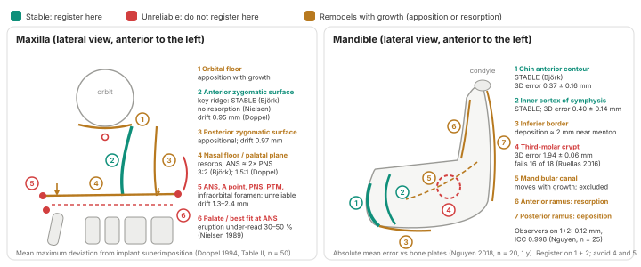
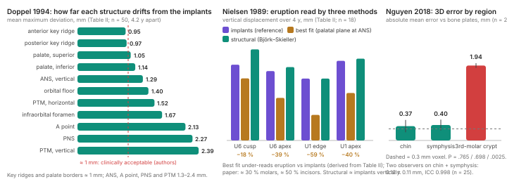

# Superimposition Methods: three papers

Doppel DM, Damon WM, Joondeph DR, Little RM. An investigation of maxillary superimposition techniques using metallic implants. Am J Orthod Dentofacial Orthop 1994;105(2):161-168.

Nielsen IL. Maxillary superimposition: a comparison of three methods for cephalometric evaluation of growth and treatment change. Am J Orthod Dentofacial Orthop 1989;95(5):422-431.

Nguyen T, Cevidanes L, Franchi L, Ruellas A, Jackson T. Three-dimensional mandibular regional superimposition in growing patients. Am J Orthod Dentofacial Orthop 2018;153(5):747-754.

## Bottom line

Against metallic implants, the anterior surface of the zygomatic process best holds its sagittal position through adolescent growth, while a palatal best fit registered at ANS hides about 30 % of molar and 50 % of incisor eruption over four years. In the mandible, Björk's anterior chin and inner symphyseal cortex stay within about one 0.3 mm voxel of bone-anchor plates over a year in 3D; the third-molar crypt errs by almost 2 mm. All three studies are retrospective and selected on image quality, so they give the direction and size of method bias, not a correction factor.

## The three studies

| Paper | Design | Sample | Gold standard | Main result |
|---|---|---|---|---|
| Doppel 1994 | Retrospective: maximum drift of 17 maxillary structures after implant superimposition of serial lateral cephalograms; six anatomic methods illustrated on one case | 50 of ≈ 700 implant records (23 M, 27 F); T1 11.9 ± 1.4 y, T2 16.0 ± 1.7 y, interval 4.2 ± 0.96 y; mostly treated | Three tantalum implants (below ANS, zygomatic process, palate medial to the first molar) | Zygomatic surfaces drift ≈ 1 mm; ANS, PNS, PTM, A point, infraorbital foramen and palatal borders judged unreliable; orbital floor rises 1.5 × what the palate lowers |
| Nielsen 1989 | Retrospective: best fit (palatal plane at ANS), implant and structural (Björk–Skieller) superimpositions on the same films; landmark displacement in a Downs occlusal-plane grid; second observer for the structural method | 18 of 35 implant subjects (6 M, 12 F); T1 10 ± 0.37 y; interval 4 ± 0.56 y; treated and untreated, mostly Class II | Tantalum implants in the zygomatic process (≥ 3–4 stable) | Best fit under-reads vertical change at every landmark; the structural method shows no vertical bias and a ≈ 0.5 mm horizontal offset |
| Nguyen 2018 | Retrospective 3D CBCT (0.3 mm voxels), voxel-based registration; aim 1 stability of three regions, aim 2 interobserver reproducibility | Aim 1: 20 Class III bone-anchor patients, 12.1 ± 1.3 to 13.3 ± 1.1 y. Aim 2: 25 growing patients (10 Herbst, 10 Class II elastics, 5 Class III), 12.7 ± 1.4 y, CVM 2–5, 12.6 ± 0.9 months | Bone plates and screws at the incisor apices, immobile clinically | Chin and inner symphysis stable; third-molar crypt not; two observers agree to 0.12 mm |

## What they found

Doppel's Table II ranks 17 maxillary structures by mean maximum deviation from the implant fit: the internal palate and both zygomatic surfaces drift 0.85–0.97 mm, the palatal borders 1.05–1.14 mm, every other landmark 1.27–2.39 mm. Nielsen's implants placed ANS 1.62 mm lower and PNS 2.34 mm further back after four years (Table I); best fit showed ANS slightly higher and PNS 1.18 mm back; the structural method matched the implants vertically and sat 0.53–0.66 mm off horizontally. Nguyen's plate registration left the chin and symphysis within 0.40 mm and the third-molar crypt 1.94 mm out; two observers differed by 0.12 ± 0.11 mm.

| Paper | Key numbers |
|---|---|
| Doppel 1994 | Internal palate 0.85 ± 0.43; anterior zygomatic 0.95 ± 0.57 (traceable in 40 of 50; drift anterior 27.5 %, posterior 35 %, none 37.5 %); posterior zygomatic 0.97 ± 0.43 (traceable in all, posterior in every case); palatal borders 1.05 / 1.14; ANS 1.29 (vertical) / 1.43 (horizontal); A point 2.13 ± 1.63; PNS 2.27 ± 1.75 (visible in 27 of 50); PTM 2.39 (vertical) / 1.52 (horizontal) mm. Palatal plane vs implant line +0.92 ± 2.10° (range −5° to +8°); SN −0.56 ± 2.19°. Tracing error 0.5 mm |
| Nielsen 1989 | Implant minus best fit, vertical: PNS 1.08, ANS 1.88, A point 2.24 mm (P < .001); U6 cusp 1.33, U6 apex 1.46, U1 edge 1.84, U1 apex 1.71 mm. Share of eruption missed: 28–59 % by landmark (derived from Table II). Best fit places landmarks 1.1–1.7 mm more anterior than implants (Tables III–IV). Implant minus structural: vertical −0.04 to −0.33 mm (NS); horizontal 0.53–0.66 mm, P < .01 (A point 0.41, NS). Interobserver differences (structural) significant only vertically: ANS 0.88, A point 0.77, U1 edge 0.86 mm |
| Nguyen 2018 | Chin 0.37 ± 0.16 (P = .765); symphysis 0.40 ± 0.14 (P = .698); crypt 1.94 ± 0.06 mm (P = .0025). Interobserver 0.12 ± 0.11 mm; ICC 0.998 (95 % CI 0.995–1.000); one subject < 0.25 mm over the whole mandible, 75 % of the surface within 0.12 mm. Sample size for ICC 0.75 vs 0.95 (α .05, power .80): 25 |

## Strengths

- Implant or plate reference standards on the same images; Doppel's 50 cases remain the largest such series.
- Within-subject comparison in Nielsen, with anatomic tracings made blind to the implants.
- Doppel's Figures 1–7: one case under six anatomic registrations against the implants.
- Nguyen pairs validity with reliability and registers voxels, not landmarks.
- The findings match the remodelling biology described by Björk, Skieller and Enlow.

## Limitations

- Selection on the reference standard or image quality: 7 % of Doppel's records (derived), 18 of 35 films in Nielsen, unreported screening in Nguyen.
- Statistics: none in Doppel; an unnamed test and 64 uncorrected comparisons in Nielsen; an unnamed test and an undefined ICC variable in Nguyen.
- Treated and untreated pooled (Doppel, Nielsen) or all treated (Nguyen).
- Doppel's metric mixes maxima for points with averages for surfaces and cannot separate consistent drift from random error.
- Nguyen's plates lie beside the chin and 30–40 mm from the crypts, were checked clinically only, and the interval is one year.

## Points for discussion

1. Doppel's smallest drift (internal palate, 0.85 ± 0.43 mm) was overruled on inspection, and the palatal borders ranked 4th and 5th (1.05 and 1.14 mm) are called unreliable in Conclusion 6; no threshold is stated.
2. The posterior zygomatic surface moved posteriorly in 50 of 50 cases yet is named among the most reliable structures; Nielsen rejects Riedel's registration on it for the same apposition.
3. Björk & Skieller's 3 : 2, Doppel's 1.5 : 1 (stated without a table) and the ABO's 3/5 : 2/5 are one ratio; Nielsen used 1 : 1 and showed a −0.04 to −0.33 mm vertical over-read.
4. Nielsen's structural horizontal offset is ≈ 0.5 mm; the Discussion calls it posterior, Tables I–II place structural landmarks 0.5–0.75 mm more anterior than implants.
5. The 2D mandibular list (chin, inner symphysis, canal, third-molar bud before roots) reduces in 3D to chin and symphysis; the crypt stage of Nguyen's 12–13-year-olds is not stated.

## What it means when we read our own cases

- A palatal superimposition under-reads descent of the maxilla and its teeth, by 1–2 mm over several growing years.
- The structural method carries no vertical bias but a horizontal offset of about 0.5 mm; smaller sagittal changes cannot be claimed from it.
- Doppel's 0.5 mm tracing error is the floor for any 2D tooth-movement claim.
- Mandibular superimposition belongs on the anterior chin and inner symphyseal cortex, not on the lower border, the ramus or a corpus axis through Xi.
- 3D voxel registration reaches 0.1–0.4 mm but needs paired CBCT (about 0.1 mSv per scan against 0.005 mSv for a cephalogram, Proffit).

## How it sits with the textbook and later evidence

- Proffit, Contemporary Orthodontics (Ch 6, Figs 6.58–6.60): three superimpositions; the maxillary legend, as transcribed, reads "maximum contour of the maxilla", not the structural registration Nielsen validated.
- ABO Cephalometric Review (rev. 3.14.2025): maxilla on the zygomatic processes, orbital floors and palatal floor, 3/5 : 2/5; mandible on the symphysis, inner cortical plate, canal and third-molar bud before roots; cites Doppel and Nielsen as validation.
- Gu & McNamara 2008 (Angle Orthod 78:967-976): in 10 implant subjects the ABO maxillary method as then described underestimated vertical displacement.
- Springate & Jones 1998 (AJODO 113:263-270): 23 implanted children; Björk's structural method close to implants, Ricketts' corpus axis rotated at Xi, errors ≥ 4 mm in ≈ 10 %.
- Graf 2022 (Eur J Orthod 44:477-490): 25 of 27 superimposition studies at high risk of bias; no cephalometric method proved accurate.

## Reporting notes

Printed values that differ within the same paper.

| Paper | Printed | Elsewhere in the paper |
|---|---|---|
| Doppel | Infraorbital foramen "accurately traced in only 32 %" (Results) | Table II n = 34 of 50 (68 %); PNS "visible in 52 %" against n = 27 (54 %) |
| Doppel | Table III minimum 8°, maximum −5° (palatal plane); 9°, −6° (SN) | Columns reversed; the text gives −5° to +8° and −6° to +9° |
| Doppel | Ratio "1.5 to 1 mm" (abstract, Conclusion 2); "1:5 to 1 mm" (p 165) | No table or measurement supports the ratio; reference 22 is dated 1910 |
| Nielsen | Table IV footnote \*\* P < .001, \*\*\* P < .0001 | Table III footnote \*\* P < .01, \*\*\* P < .001; Table IV's values fit Table III's thresholds |
| Nielsen | Implant minus best fit, A point vertical 2.24 mm (Table III) | Table I means give 1.86 mm; the structural-minus-best-fit rows reproduce exactly |
| Nielsen | Fig 8 "UIE 1.71 ± 0.84" | Table IV: UIA 1.71 ± 0.84, UIE 1.84 ± 0.86 |
| Nielsen | Reference 18: Trans Eur Orthod Soc 1977;7:209-33 | Same volume and pages as reference 1 (Broadbent 1937) |
| Nguyen | Abstract: interobserver 0.12 ± 1.1 mm; symphysis 0.4 ± 0.15 mm | Results 0.12 ± 0.11 mm; Table 0.40 ± 0.14 mm |
| Nguyen | Fig 8A "Differences > 0.025 mm" | Caption and text: 0.25 mm |
| Nguyen | Table P values .765 / .698 / .0025 | No test named; third-molar SD 0.06 mm |
| Nguyen | Ruellas 2016 "16 of 18" failures; scanner "12 kV(p)" | Ruellas reports 14 of 16 (literature); CBCT runs at about 120 kVp (literature, UNVERIFIED) |
